# Week 10 Lab: Machine Learning & Dashboards

**Course:** Introduction to Big Data Analytics, AUCA

**Instructor:** Prince ISHIMWE

**Student:** Olivier IREMBERE  | **ID:** 28392 | 

## About this project

This lab covers my first machine learning models (Scikit-learn) and an interactive chart (Plotly). Using a dataset of 150 students (`week10_students.csv`), I trained a model to predict exam scores, a second model to flag students at risk of failing, tested whether extra features help, and published a dashboard.

The full code is in the submitted notebook, `Week10_YourName.ipynb`. This README summarises what I did in each exercise and shows screenshots as proof.

**Settings used throughout:** `test_size=0.25`, `random_state=42`.

## Contents

- [Part 1: Explore & Split](#part-1-explore--split)
- [Part 2: Regression](#part-2-regression)
- [Part 3: Classification](#part-3-classification)
- [Part 4: Feature Engineering](#part-4-feature-engineering)
- [Part 5: Dashboard](#part-5-dashboard)
- [Bonus](#bonus)
- [Part 6: Model Card](#part-6-model-card)
- [Summary of Results](#summary-of-results)

---

## Part 1: Explore & Split

### Exercise 1.1: Know your data
**What I did:** Loaded the CSV, printed its shape, and measured how strongly each feature is correlated with the exam score.

**Result:** The data has 150 rows and 9 columns. Correlation with score: `quiz_avg` 0.80, `assignments_avg` 0.54, `attendance_pct` 0.24. **`quiz_avg` is the most useful feature.**

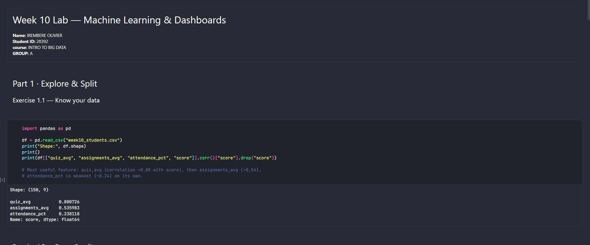

### Exercise 1.2: Frame & split
**What I did:** Set the three features as X and `score` as y, then split into 75% train and 25% test.

**Result:** **112 train / 38 test** (matches the checkpoint). 25% of students are hidden so the model can be tested on students it has never seen. Testing on the data it learned from would only measure memorisation.

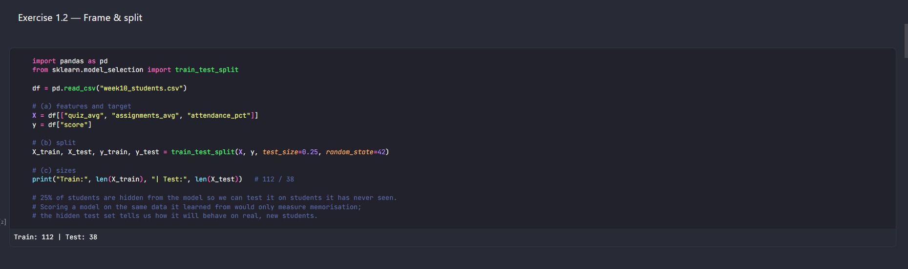

---

## Part 2: Regression

### Exercise 2.1: Train & read the model
**What I did:** Trained a `LinearRegression` model and printed each feature's coefficient and the intercept.

**Result:** `score ≈ 0.58 × quiz + 0.37 × assignments + 0.11 × attendance − 4.4`. **One extra quiz point is worth about 0.58 exam points.**

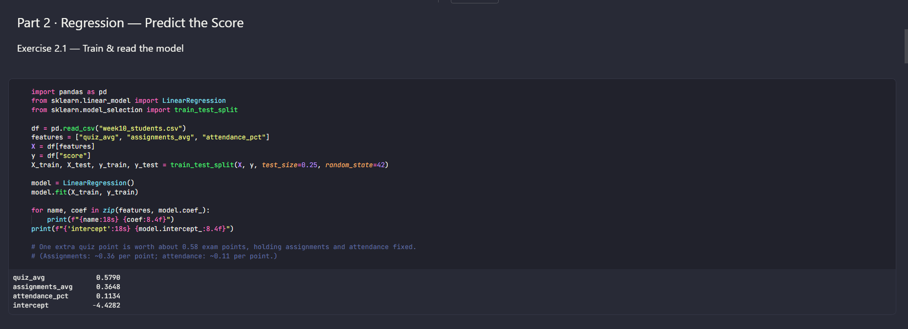

### Exercise 2.2: Judge it honestly
**What I did:** Predicted on the test set and measured MAE and R².

**Result:** **MAE = 3.33, R² = 0.89** (matches the checkpoint).
- **MAE:** predictions are typically off by about 3 points.
- **R²:** the model explains about 89% of the differences between students' scores.

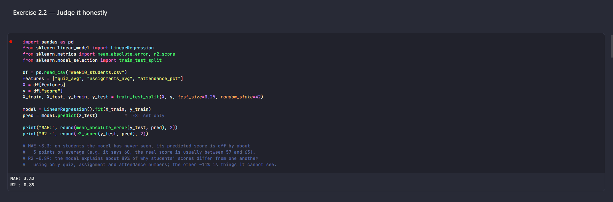

### Exercise 2.3: Predict a new student
**What I did:** Predicted the score of a new student (quiz 70, assignments 75, attendance 90), then my own with invented numbers (60, 65, 85).

**Result:** New student: **73.7**. Me: **63.7**.

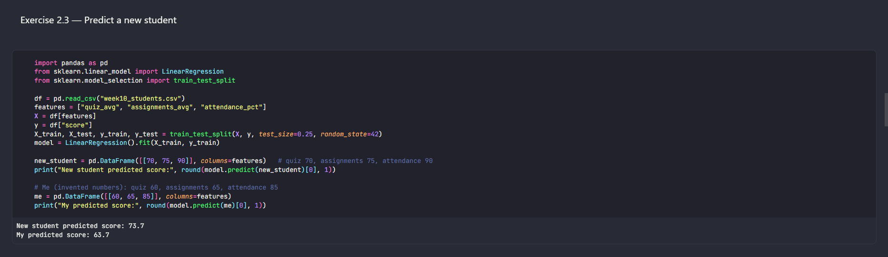

---

## Part 3: Classification

### Exercise 3.1: Build the target & train
**What I did:** Created a `passed` column (1 if score ≥ 50, else 0), printed the counts, and trained a `LogisticRegression` model.

**Result:** **131 passed, 19 failed.** The classes are imbalanced.

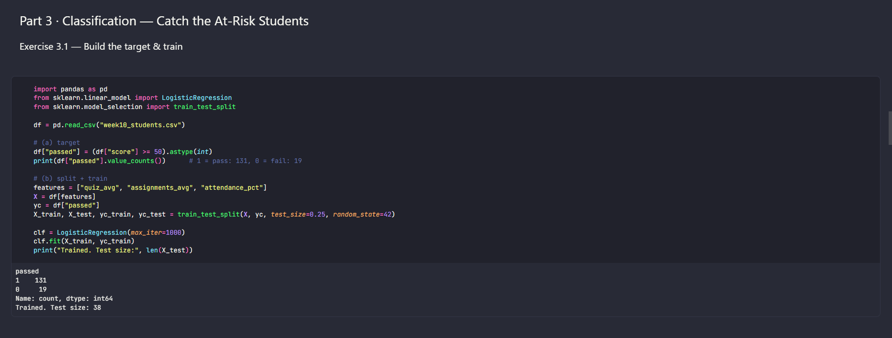

### Exercise 3.2: The accuracy trap
**What I did:** Compared the model's accuracy with a lazy baseline that predicts "pass" for everyone, and printed the confusion matrix.

**Result:** Model accuracy **0.895**, lazy baseline **0.895**. Confusion matrix: `[[3, 1], [3, 31]]`

| | Predicted fail | Predicted pass |
|---|---|---|
| **Actually failed** | 3 (caught) | 1 (missed) |
| **Actually passed** | 3 (false alarms) | 31 (correct) |

**Is the model useless? No.** Both score 89.5% only because about 90% of students pass. The lazy model catches **0 of the 4** failing students, while our model catches **3 of 4**, which is the job an early-warning system exists to do. Accuracy hides this, so the confusion matrix must always be read.

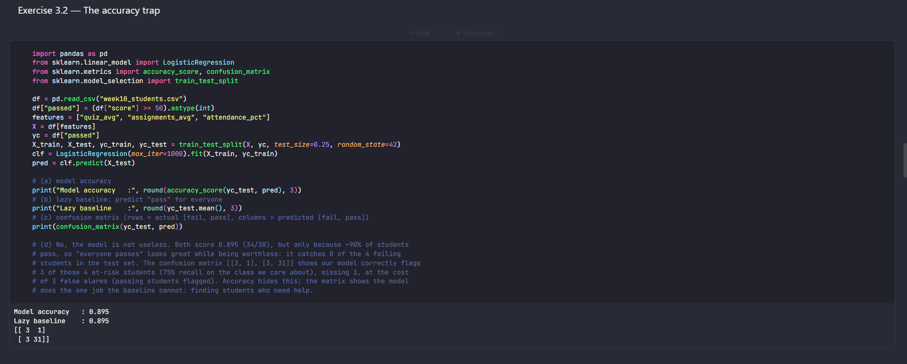

---

## Part 4: Feature Engineering

### Exercise 4.1: Does more information help?
**What I did:** Compared test-set R² for three versions of the regression, using the same split each time.

| Version | Test R² |
|---|---|
| 1. `quiz_avg` only | 0.62 |
| 2. All three numeric features | 0.89 |
| 3. Three features + program (one-hot encoded) | 0.88 |

**What helped:** adding assignments and attendance (0.62 to 0.89), because they add new, relevant information.
**What didn't:** adding program (0.89 to 0.88), because it tells the model almost nothing beyond the marks.
**Lesson:** more data only helps if it is new, relevant information, so test each addition on unseen data.

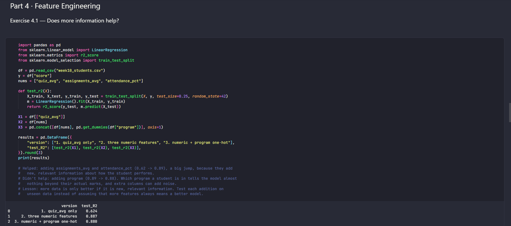

---

## Part 5: Dashboard

### Exercise 5.1: The story in three charts
I built three Plotly charts that tell one story.

**Chart 1: "1. Where the class stands" (context).** Histogram of scores, 12 bins.
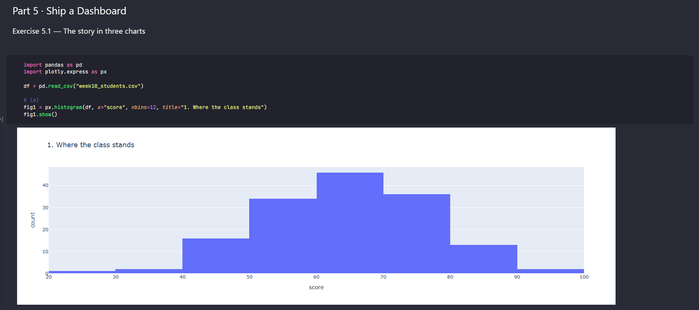

**Chart 2: "2. Who is at risk" (insight).** Scatter of quiz average vs score, coloured by pass/fail, with student names on hover.
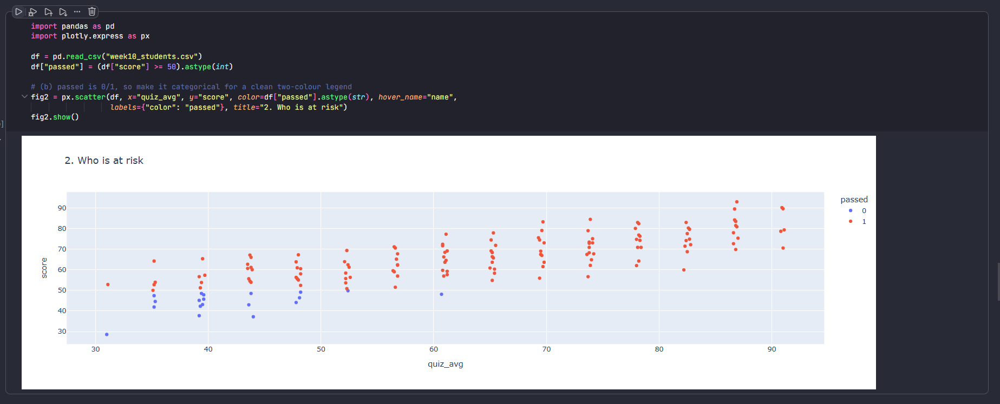

**Chart 3: "3. Where to act" (action).** Bar chart of average score per district.
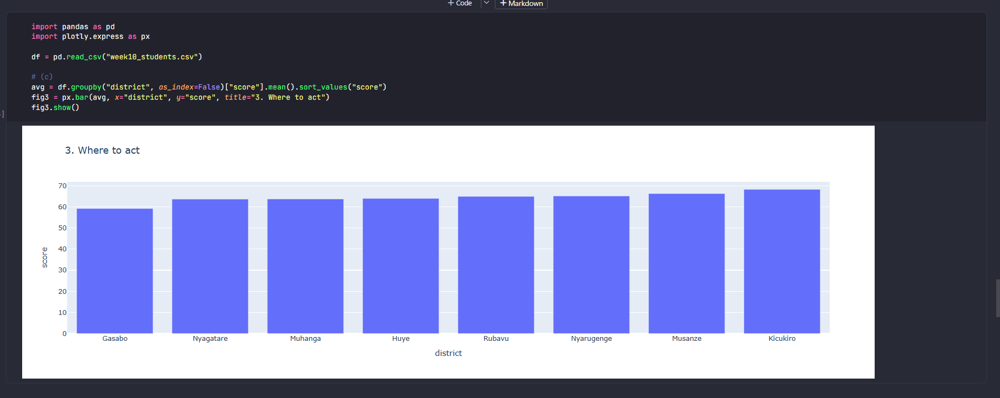

### Exercise 5.2: Publish it
**What I did:** Saved the at-risk scatter as an interactive web page, [`class_dashboard.html`](class_dashboard.html), and opened it in a browser to hover over the points.

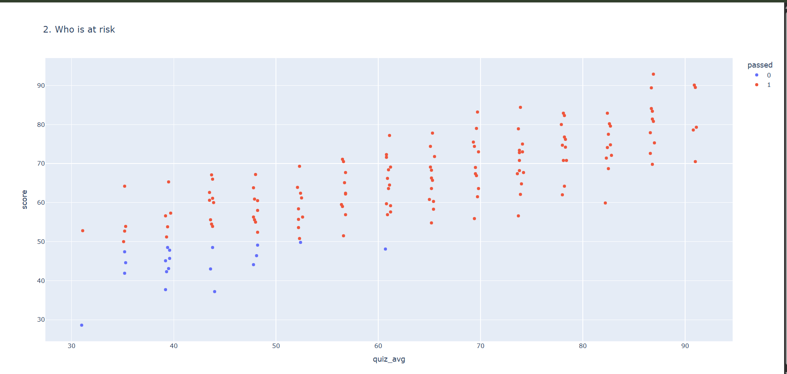

---

## Bonus

**One chart, four stories:** a box plot of scores by program.

**Result:** **Networking** is the most consistent (smallest spread). **Software Engineering** has the widest spread.

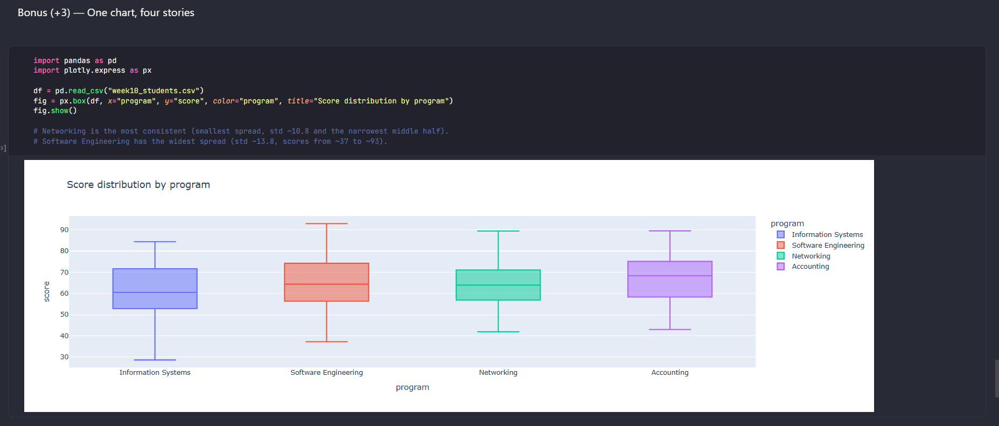

---

## Part 6: Model Card

**Student Score Predictor (Linear Regression)**

1. **Purpose:** predicts a student's final score (0 to 100) so lecturers can spot early who may struggle and offer support sooner.
2. **Data & features:** 150 clean student records. Inputs: `quiz_avg`, `assignments_avg`, `attendance_pct`. Target: `score`. Trained on 112 students, tested on 38 unseen ones.
3. **Performance:** MAE about 3.3 points (predictions are typically about 3 points off) and R² about 0.89 (the model explains about 89% of the differences between students). Only 38 students were tested, so the numbers are approximate.
4. **Risks:**
   - A wrong prediction could label a capable student as failing (stigma, lower expectations) or miss a student who needs help.
   - The model only sees three numbers, not illness, family problems or workload, and it may not fit other years or programs.
   - If past data is unfair (by gender, district or wealth), a model trained on it would repeat that unfairness.
   - **Use it** as an early-warning signal to start a conversation and offer support.
   - **Do not use it** to decide grades, scholarships, discipline or admission, or without a lecturer reviewing each case.

---

## Summary of Results

| Item | Result |
|---|---|
| Dataset | 150 students |
| Split | 112 train / 38 test |
| Strongest feature | `quiz_avg` (r = 0.80) |
| Regression MAE / R² | 3.33 / 0.89 |
| Classification accuracy | 0.895 (equal to the lazy baseline) |
| Confusion matrix | `[[3, 1], [3, 31]]` (3 of 4 failing students caught) |
| R² progression | 0.62 → 0.89 → 0.88 |
| New student (70, 75, 90) | 73.7 |

## Files

| File | Description |
|---|---|
| `Week10_YourName.ipynb` | Submitted notebook with all code |
| `week10_students.csv` | Dataset |
| `class_dashboard.html` | Interactive dashboard |
| `submissions/screenshots/` | Screenshots of every exercise |
